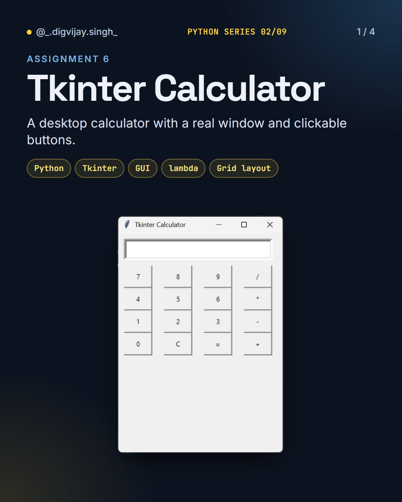
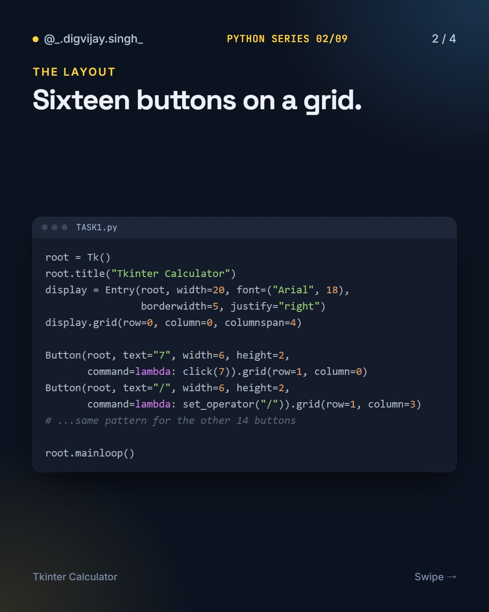
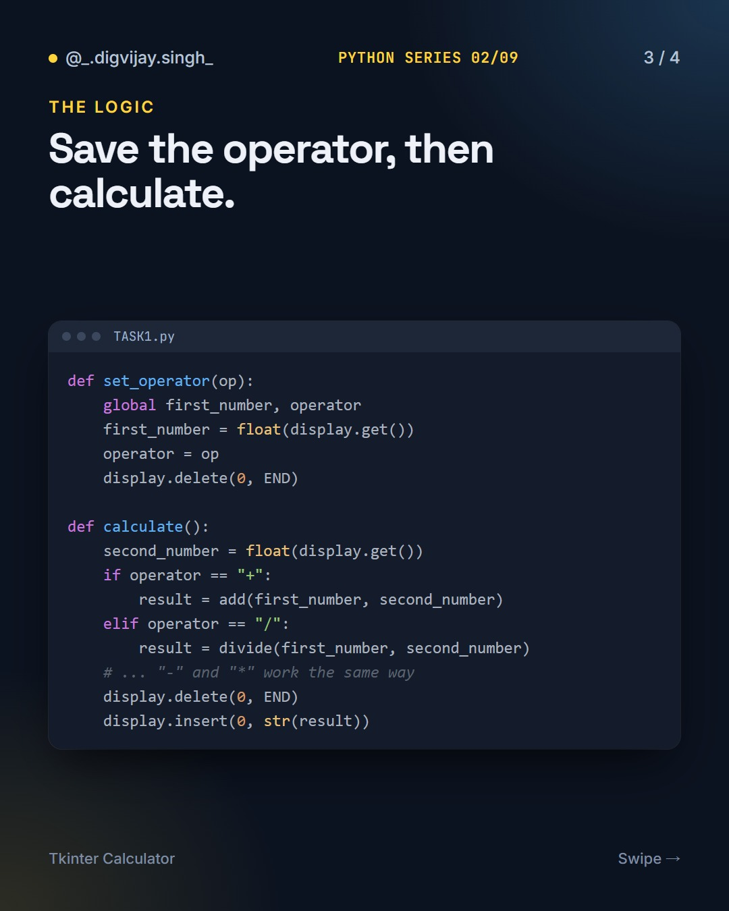
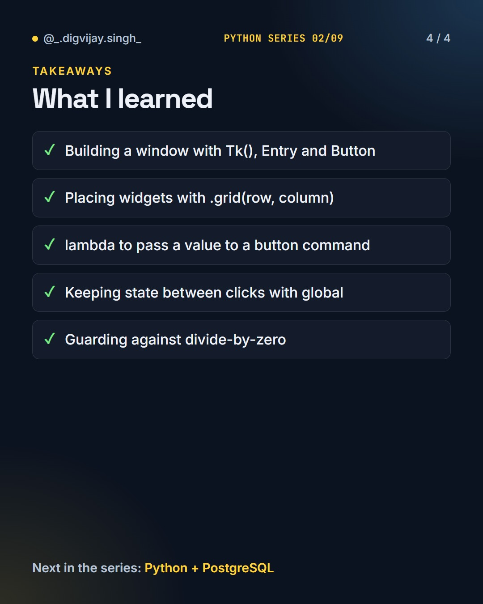

# Tkinter Calculator

<p align="center"></p>

A desktop calculator in Python with a real window and clickable buttons, built with Tkinter.

Part 2 of 9 in my **Python Series**.

## How to run

Tkinter ships with Python, so there is nothing to install:

```bash
python calculator.py
```

## What I learned

- Building a window with `Tk()`, `Entry` and `Button`
- Placing widgets with `.grid(row, column)`
- `lambda` to pass a value to a button command
- Keeping state between clicks with `global`
- Guarding against divide-by-zero

## Slides

<p>



</p>

## The Python Series

1. [Python Basics](https://github.com/digvijay165/python-basics)
2. **Tkinter Calculator**
3. [Python + PostgreSQL](https://github.com/digvijay165/python-postgresql)
4. [Flask Registration Form](https://github.com/digvijay165/flask-registration-form)
5. [Django REST Blog API](https://github.com/digvijay165/django-rest-blog-api)
6. [Python Web Scraper](https://github.com/digvijay165/python-web-scraper)
7. [OpenCV Practicals](https://github.com/digvijay165/opencv-practicals)
8. [Selenium Automation](https://github.com/digvijay165/selenium-automation)
9. [Python Chat App](https://github.com/digvijay165/python-chat-app)
